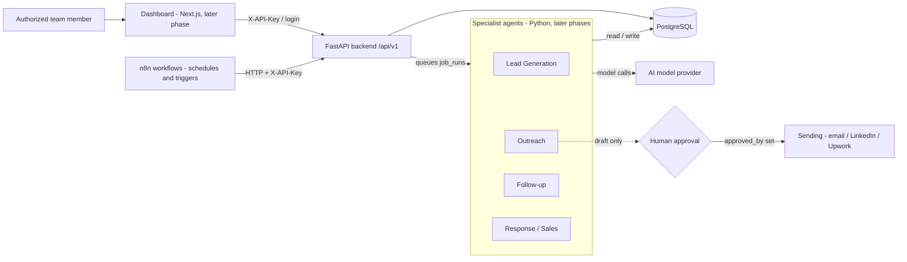

# Orbit V1 - Architecture (draft)

## Boundaries
- **n8n** only schedules and triggers; it calls the backend API and holds no business data.
- **FastAPI** is the single entry point for data changes, validation, access control and audit logging.
- **Agents** never talk to each other; they communicate only through PostgreSQL rows (`leads.status`, `job_runs`, ...).
- **Nothing is sent without human approval** (enforced in the database: approved/sent messages need `approved_by`).
- Every agent checks `opt_outs` before preparing or sending anything.

## Failure handling
- `job_runs` stores status, `attempt`, `max_attempts`, `error_message`; failed jobs go to `retrying` until max attempts, then `failed`.
- `idempotency_key` makes repeated triggers safe (same key returns the same job).
- Duplicates: `companies.domain` is unique; `contacts` unique per `(company_id, email)`.
