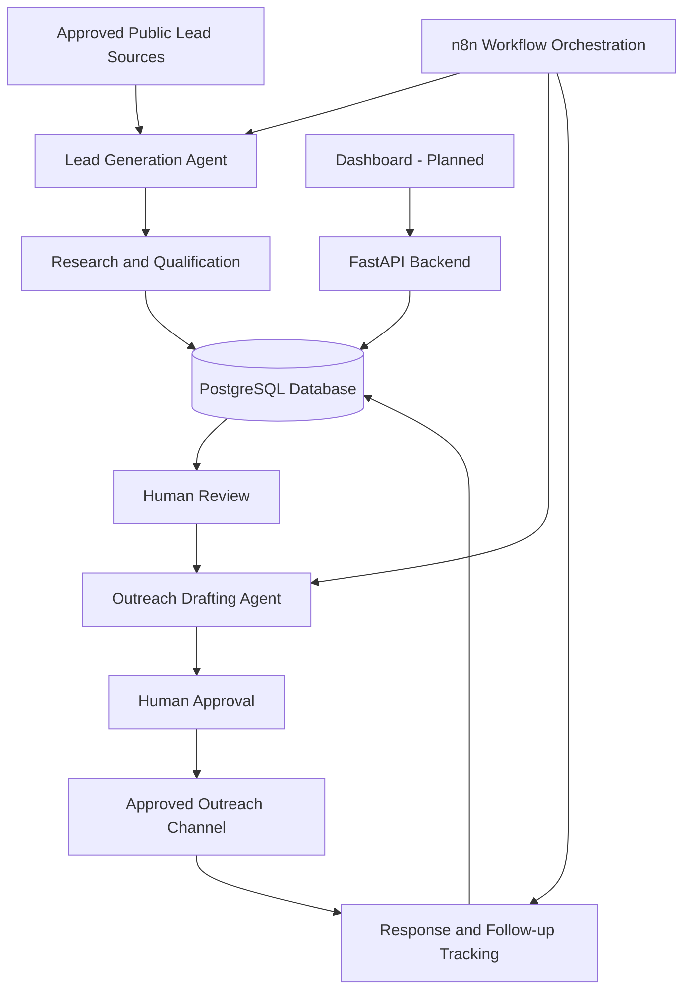

# Orbit V1 Architecture Diagram

**Status:** Proposed architecture — draft for team review.

## Architecture Overview

## System Boundaries

* **Lead Generation Agent:** Discovers, researches, qualifies, scores, and prioritizes prospects.
* **Outreach Agent:** Prepares personalized outreach drafts using company research.
* **Follow-up and Response:** Tracks interactions, classifies responses, and respects replies and opt-outs.
* **n8n:** Coordinates scheduled and event-driven workflows.
* **FastAPI:** Provides backend API endpoints for application functionality.
* **PostgreSQL:** Stores shared prospect and sales-pipeline data.
* **Dashboard:** Planned interface for authorized team members to review and monitor sales activities.
* **Human Approval:** Outreach must be reviewed and approved before it is sent.

## Important Note

This diagram represents the proposed Orbit V1 architecture for Phase 1 review. It does not mean that every agent or dashboard feature has already been implemented. The architecture and integrations should be reviewed and approved before further development.
