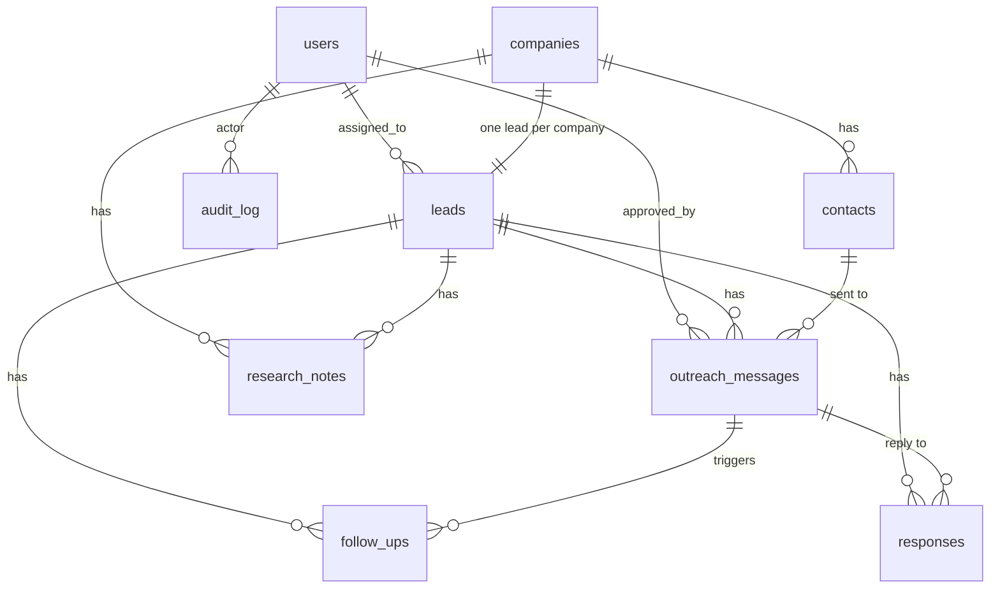

# Orbit V1 - Data model (draft)

| Table | Purpose | Key rules |
|---|---|---|
| users | Authorized team members | role: admin / member |
| companies | Prospect companies | `domain` UNIQUE (normalized) = de-duplication key |
| contacts | People at a company | UNIQUE (company_id, email) |
| leads | Pipeline record per company | status, score 0-100, `ai_signals` JSON |
| research_notes | AI/human research | source URL, model used |
| outreach_messages | Drafted messages | channel email/linkedin/upwork; approved or sent requires `approved_by` |
| follow_ups | Scheduled follow-ups | due_at + status, attempt number |
| responses | Incoming replies | classified intent, recommended action |
| opt_outs | Do-not-contact list | by email and/or domain |
| audit_log | Who did what and when | actor, action, entity, details |
| job_runs | Agent/workflow runs | status, attempts, error, idempotency key |

Lead status flow: `new -> researched -> qualified | disqualified -> contacted -> replied -> won | lost`.

Open questions for review: store LinkedIn data at all (platform terms)? Retention period for contact data? Do we need multiple leads per company later?
